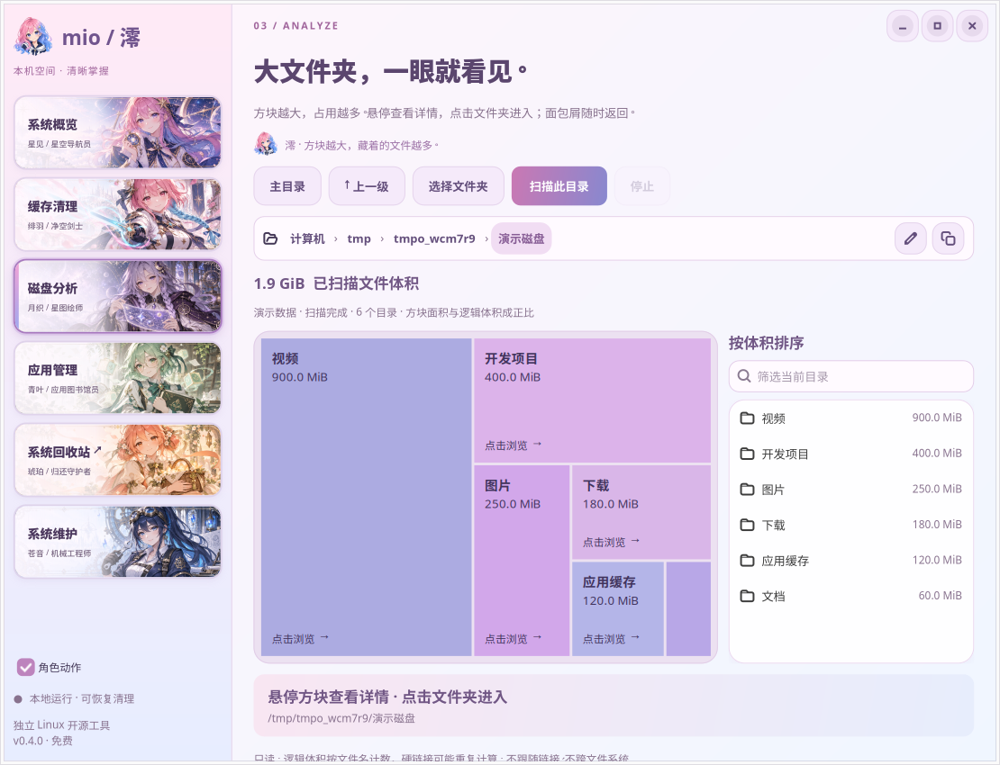
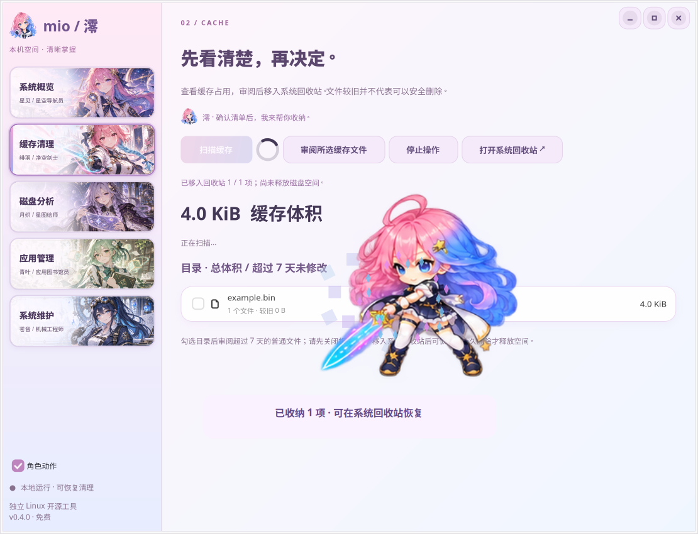

<p align="center"></p>

# Mio · 澪

一个免费、开源的原生桌面工具，让磁盘空间一眼可见。面向 Ubuntu / Linux，使用 Python、GTK 4 和 libadwaita。

这是 [Mole CLI](https://github.com/tw93/Mole) 的独立 GPL-3.0 fork。Mio 使用自己的名称、图标和 Linux 适配器，与 Mole 官方没有隶属关系。官方 Mac GUI 是单独的专有产品，本项目没有包含它的源码或资源。

**当前版本：0.4.0。** 支持磁盘面积图、可恢复缓存清理、系统回收站、APT / Snap / Flatpak 软件包卸载和常用系统维护。实际清理和恢复已通过临时文件测试；没有对开发机器执行卸载或系统清理。



## 磁盘分析

- **面积就是体积**：大文件夹占据更大方块，直接看到空间分布。
- **悬停查看**：显示路径、逻辑大小与当前层级占比。
- **点击下钻**：文件夹点击即进入，已扫描的目录从内存切换，无需重扫。
- **面包屑返回**：路径栏、上一级和主目录按钮快速导航。
- **配套列表**：按体积排序、筛选名称、分批加载全部直接子项；支持键盘操作。
- **后台扫描**：显示已检查条目和已统计体积，可随时停止；停止、超时、条目上限或权限问题产生的部分结果会明确标注。

面积图最多显示 80 个区块，较小条目合并为“其余项目”，可在完整列表中查找。空文件和空目录仍保留在列表中。

## 启动

需要 Linux 图形会话、Python 3.10+、GTK 4.12+、libadwaita 1.4+、PyGObject 和 Pycairo。当前在 Ubuntu 26.04 / GTK 4.22 / libadwaita 1.9 上验证。

```bash
sudo apt install python3-gi python3-gi-cairo gir1.2-gtk-4.0 gir1.2-adw-1 psmisc gvfs
git clone https://github.com/JamesbbBriz/mio.git
cd mio
./run.sh
# 安装应用菜单入口和桌面快捷方式（使用当前仓库路径）
python3 -m mio_linux.desktop
```

启动脚本使用系统 `/usr/bin/python3`，无需 pip、Node.js、API 密钥或网络服务。根目录原有的 `mo`、`mole` 和 `install.sh` 属于上游 macOS CLI，不能作为 Mio 的 Linux 安装入口。

## 角色界面与动作

五个导航入口采用整张可点击角色插画卡片，各有不同人物、配色与道具，并保留原生文字、键盘焦点和选中边框。[角色素材与生成提示词](docs/navigation-artwork.md)。

导航、卡片、按钮、路径栏、输入框、弹窗和磁盘方块统一使用粉蓝二次元主题。澪会在清理实际成功后冲入界面挥刀，缓存碎片化作星屑；提示明确写出“已收纳 / 可从系统回收站恢复”。零成功、失败或取消不会触发成功动画，部分成功显示未处理数量。清理后会刷新当前缓存列表。

主页可预览动作（不操作文件）；侧栏可关闭角色动作，系统关闭动画时改用静态完成提示。动画不拦截输入、不改变文件操作，也不把移入回收站称为已释放空间。



## 其他功能

- **缓存清理**：扫描 `$XDG_CACHE_HOME` 或 `~/.cache`，勾选目录后审阅具体文件。只移动超过 7 天的普通文件；正在使用、状态未知、硬链接、符号链接和跨文件系统的文件不清理。请先关闭相关应用。
- **系统回收站**：通过 GIO/GVfs 接入 `trash:///`，与 GNOME 文件管理器共用同一份内容。Mio 清理的文件可以在文件管理器恢复，恢复、查看和永久删除统一在系统文件管理器完成；Mio 只保留“打开系统回收站”快捷入口，不再重复提供回收站管理页面。移动到回收站不会释放空间。旧版独立回收文件提供单独的审阅迁移入口，遇到原位置冲突会保留旧副本。
- **软件管理**：桌面入口搜索之外，提供 APT、Snap 和 Flatpak（标准 user/system 安装）软件包清单。APT 卸载先模拟，再由终端中的包管理器展示实际依赖变化并确认。保留用户配置；不按名称猜测残留目录。
- **系统维护**：刷新软件源、安装更新、检查依赖、清理 APT 下载缓存、保留最近 14 天的归档日志。后两项不可恢复，执行前明确说明。
- **桌面图标**：安装脚本将原创粉蓝少女图标和 Mio 启动器安装到当前用户的应用菜单及桌面；移动仓库后需重跑安装脚本。GNOME 若仍显示未信任启动器，可右键选择“允许启动”。

软件包和维护操作需要桌面终端（Ptyxis、GNOME Terminal 或 xdg-terminal-exec）。管理员密码由 sudo 在终端处理，Mio 不接触密码。每次操作先在 Mio 审阅，再在终端输入 YES；包管理器自身的确认流程仍保留。终端退出码回传到维护页，事务记录保存在 `~/.local/state/mio/operations`。GUI 关闭不会杀死正在进行的软件包事务。

系统概览每 2 秒更新 CPU、内存和主目录所在磁盘使用情况。

## 扫描边界

扫描只读取文件元数据。变更操作必须经过单独审阅，采用参数数组调用系统程序，不拼接 shell 命令。回收操作按文件逐项处理，部分失败明确报告。应用打开文件与最终移动之间不存在全局锁，因此先关闭相关应用，且在确认无误前保留回收副本。完整边界见 [操作设计与审查](docs/operations-design.md)。上游 macOS CLI 未由本次开发修改或重新验证。

扫描不跟随符号链接、不跨文件系统、跳过特殊文件。路径或祖先为符号链接时拒绝扫描。磁盘扫描最多 60 秒、500,000 项及 128 层深度；缓存扫描最多 20 秒、200,000 项。部分结果的面积与占比仅代表已测量的内容。

显示的是普通文件的**逻辑大小**，按文件名计数，硬链接可能重复计算；稀疏文件、压缩和共享块会使它不同于实际磁盘占用。旧缓存不等于安全可删，也不等于可回收空间。结果保存在本次会话内；文件变化后可重新扫描。

## 开发与验证

```bash
python3 -m unittest discover -s tests -p 'test_*.py' -v
python3 -m tests.smoke_gui
```

后端、操作与面积图测试覆盖文件统计、树级汇总、取消、预算、符号链接、权限错误，以及方块面积比例、边界和不重叠。GUI 测试使用临时稀疏文件，不扫描私人目录；验证五个页面和清理页的系统回收站快捷入口、点击下钻、缓存导航、面包屑、列表筛选、应用搜索、确认清理、实际恢复和模拟的包管理分发，将截图和报告写到 `artifacts/`。系统回收站互通测试另用独立 HOME、XDG 目录和 D-Bus 会话，验证文件管理器协议互通、目录恢复/删除、同名冲突、链接目标保护和旧版迁移，不接触真实回收站。图形会话不可用时请在 Xvfb 下运行。

更多信息见 [贡献指南](CONTRIBUTING.md)、[上游说明](UPSTREAM.md) 和 [图标生成记录](docs/branding.md)。

## 后续方向

更多分发格式与安装打包。当前不包含 AppImage 卸载、Flatpak 自定义命名安装、自动残留删除或 Mac 专属功能。需要原生 Mac 样本时，再用 REA 辅助补充结构与交互分析。目前尚未进行官方 GUI 逆向分析。

## 许可与致谢

代码按 [GPL-3.0](LICENSE) 分发。感谢 [tw93/Mole](https://github.com/tw93/Mole) 及其贡献者；上游历史和代码署名保留。Mio 的 Linux GUI 与扫描适配器独立编写，参考公开的扫描、审阅和磁盘下钻工作流。

Mio 的原创少女图标由内置图像生成工具生成，项目内以 CC0-1.0 提供；不包含 Mole 官方名称标志或专有 GUI 素材。完整提示词和资产说明见 [branding.md](docs/branding.md)。
